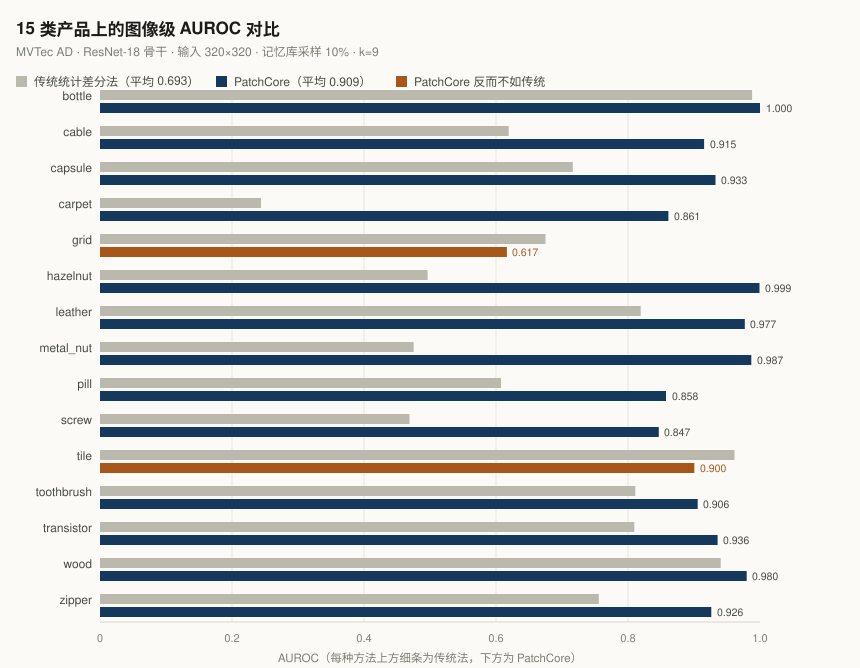
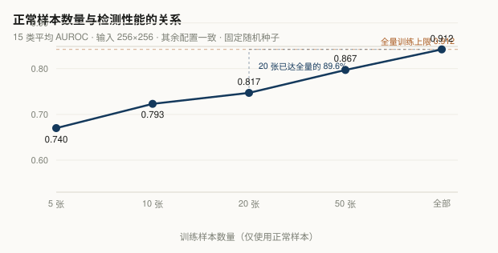

# 工业表面缺陷的无监督检测

> 只用正常样本训练的缺陷检测与定位系统 —— 基于 MVTec AD 的 PatchCore 复现、对比实验与可视化演示


---

## 一句话

工业质检的缺陷样本天然稀缺（良品率 95%–99%，一个可用模型却要每类 500–1000 张缺陷标注）。
本项目反过来做：**只让模型看正常品**，缺陷以「偏离正常」的形式被自动发现。

---

## 核心结果

| 任务 | 指标 | 传统统计差分 | PatchCore | 变化 |
| --- | --- | --- | --- | --- |
| 图像级检测 | AUROC（15 类平均） | 0.693 | **0.909** | +0.217 |
| 数据需求 | 20 张正常图 vs 全量 | — | **89.6%** | 少样本可行 |
| 像素级定位 | IoU / Recall（15 类平均） | — | 0.235 / 0.393 | 定位是真实短板 |

**三个关键发现**

1. **检测不等于定位。** tile 类检测 AUROC 高达 0.960，定位 IoU 却只有 0.095；grid 类定位 IoU 低至 0.002。同一模型、同一分数图，换个评价口径结论就从「可上线」变成「不可用」。
2. **PatchCore 并非全面胜出。** grid、tile 两类反而不如传统方法 —— 周期性纹理场景下，低成本方案的性价比更高。
3. **20 张正常图即可达全量 89.6%。** 限制条件从「几百张缺陷标注」降为「二十张良品图」。



---

## 快速开始

### 1. 环境

```bash
conda create -n anomaly python=3.11 -y
conda activate anomaly
```

PyTorch 必须按显卡架构选版本。RTX 50 系（Blackwell）**必须 cu128 及以上**，cu121 / cu124 会报 `no kernel image is available`：

```bash
pip install torch torchvision --index-url https://download.pytorch.org/whl/cu128
pip install -r requirements.txt
```

验证：

```python
import torch
print(torch.__version__, torch.cuda.is_available(), torch.cuda.get_device_name(0))
# 期望：2.11.0+cu128  True  NVIDIA GeForce RTX 5060 Laptop GPU
```

### 2. 数据

下载 [MVTec AD](https://www.mvtec.com/company/research/datasets/mvtec-ad)（CC BY-NC-SA 4.0，仅限非商业用途）。
官方页面在部分地区不可达时，可用 HuggingFace 镜像（目录结构与官方一致）：

```bash
export HF_ENDPOINT=https://hf-mirror.com
hf download foersben/mvtec-ad --repo-type dataset --local-dir ./data/mvtec_ad --exclude "results/*"
```

Windows 用 `set HF_ENDPOINT=https://hf-mirror.com`，且必须与下载命令在同一窗口执行。

### 3. 改路径

所有脚本顶部的 `DATA` 常量指向数据集根目录，按自己的实际路径修改：

```python
DATA = Path(r"D:\datasets\mvtec_ad")
```

### 4. 跑起来

```bash
python src/explore_data.py     # 数据统计 + 预览图
python src/evaluate.py         # 传统基线，15 类
python src/evaluate_all.py     # PatchCore 全类对比，约 20-40 分钟
python src/few_shot.py         # 少样本实验
python src/evaluate_loc.py     # 定位精度评估
```

### 5. 可视化演示

```bash
streamlit run src/demo_app.py
```

浏览器打开 `localhost:8501`。**不要用 `python demo_app.py` 启动** —— 会报 `missing ScriptRunContext` 且不启动服务。

---

## 项目结构

```
.
├── README.md
├── requirements.txt
├── .gitignore
├── src/
│   ├── explore_data.py      # 数据集统计与可视化预览
│   ├── baseline.py          # 传统差分法（单类演示）
│   ├── evaluate.py          # 传统法 15 类图像级评测
│   ├── patchcore.py         # PatchCore（单类调试）
│   ├── evaluate_all.py      # PatchCore 15 类图像级评测
│   ├── few_shot.py          # 样本数-性能曲线
│   ├── evaluate_loc.py      # 像素级定位精度（IoU / Recall）
│   └── demo_app.py          # Streamlit 交互式演示
├── results/
│   ├── results_compare.csv       # 传统 vs PatchCore 逐类 AUROC
│   ├── results_few_shot.csv      # 少样本实验结果
│   └── results_localization.csv  # 定位 IoU / Recall
├── docs/
│   ├── 技术报告.html
│   └── figures/
│       ├── auroc_comparison.svg
│       └── few_shot_curve.svg
└── data/                    # 数据集，不提交
```

---

## 方法

### 基线：统计差分法

对每个像素位置统计正常样本的均值 μ 与标准差 σ，测试图计算标准化差异：

```
score(x, y) = |I(x, y) − μ(x, y)| / (σ(x, y) + ε)
```

分母的 σ 按位置自身波动幅度归一化，使边缘、反光等天然波动大的区域不被误判。随后做高斯平滑、阈值分割与形态学开闭运算。

**代价最低，但要求像素严格对齐**——螺丝旋转两度，整个轮廓都会被判为异常。

### 主线：PatchCore

用预训练网络提取的局部纹理特征替换像素比对，判据从「亮度变了多少」变成「这块纹理在正常纹理库里有没有相似项」。

| 步骤 | 做法 |
| --- | --- |
| 特征提取 | ResNet-18（ImageNet 预训练），取 layer2 + layer3，layer3 插值对齐后拼接 |
| 邻域聚合 | `avg_pool2d(3, 1, 1)` 局部平均，提升平移容忍度 |
| 记忆库 | 收集全部正常样本特征，按 10% 采样（32768 个 patch） |
| 异常评分 | 每个特征在记忆库中查最近 9 个邻居，取均值距离 |
| 后处理 | 分数图插值回原尺寸 + 高斯平滑 |

---

## 实验设置

| 配置 | 取值 |
| --- | --- |
| 输入尺寸 | 320×320（图像级 / 定位）；256×256（少样本） |
| 记忆库采样率 | 10% |
| 近邻数 k | 9 |
| 定位阈值 | 正常样本分数 `mean + 3 × std`（最多 30 张正常图估分布） |
| 随机种子 | `torch.manual_seed(0)` / `np.random.RandomState(42)` |
| 硬件 | RTX 5060 Laptop GPU（8 GB） |

**关于阈值的一个发现**：早期版本用「当前图峰值 × 灵敏度比例」作相对阈值，定位 IoU 只有 0.008–0.034。改为由正常样本分数分布确定的**绝对阈值**后，bottle 类 IoU 从 0.034 提升到 0.727。相对阈值会让每张图都自我膨胀，是不可用的设计。

---

## 少样本能力



| 正常样本数 | 5 | 10 | 20 | 50 | 全部 |
| --- | --- | --- | --- | --- | --- |
| 平均 AUROC | 0.740 | 0.793 | 0.817 | 0.867 | 0.912 |
| 相对全量 | 81.1% | 87.0% | 89.6% | 95.1% | 100% |

收益明显递减，且**不同产品对数据的饥饿程度相差一个数量级**：bottle、hazelnut 在 5 张时已达 0.98；screw 在 5 张时仅 0.456（低于随机），grid、zipper 同样脆弱。

---

## 局限

| 局限 | 表现 | 改进方向 |
| --- | --- | --- |
| 周期性纹理失效 | grid 定位 IoU 0.0016 | 频域分析 / 多尺度特征融合 |
| 微小缺陷漏检 | transistor、tile 定位 IoU < 0.10 | 分辨率提至 512 或引入 layer1 特征 |
| 记忆库为随机采样 | 非标准 greedy coreset | 实现 k-center greedy 采样，通常 +1~3 点 |
| 单一骨干 | ResNet-18（论文用 WideResNet-50） | 换更强骨干，AUROC 有望逼近 0.98 |
| 未覆盖产线扰动 | 光照、标定漂移、批次差异 | 加入域偏移实验与在线自适应 |

本实现的 0.909 相对原论文 0.991（WideResNet-50）属轻量版本，差距主要来自骨干网络容量，而非方法本身。

---

## 演示界面

Streamlit 应用支持：类别切换、训练样本数调节（5/10/20/50/全部）、判定严格度（k×σ）控制、实时异常热力图、与人工标注的真值对比及 IoU 计算。

阈值取 k=3 时定位效果最均衡：过小导致区域膨胀，过大导致漏检。

---

## 引用

```bibtex
@inproceedings{roth2022patchcore,
  title     = {Towards Total Recall in Industrial Anomaly Detection},
  author    = {Roth, Karsten and Pemula, Latha and Zepeda, John and Sch{\"o}lkopf, Bernhard and Brox, Thomas and Gehler, Peter},
  booktitle = {CVPR},
  year      = {2022}
}

@article{bergmann2019mvtec,
  title   = {MVTec AD -- A Comprehensive Real-World Dataset for Unsupervised Anomaly Detection},
  author  = {Bergmann, Paul and Fauser, Michael and Sattlegger, David and Steger, Carsten},
  journal = {CVPR},
  year    = {2019}
}
```

---

## 许可

代码 MIT。数据集 MVTec AD 遵循 CC BY-NC-SA 4.0，仅限非商业研究用途，请勿用于商业部署。
